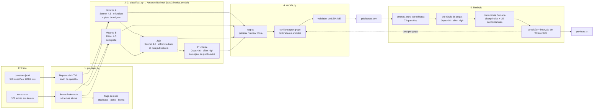
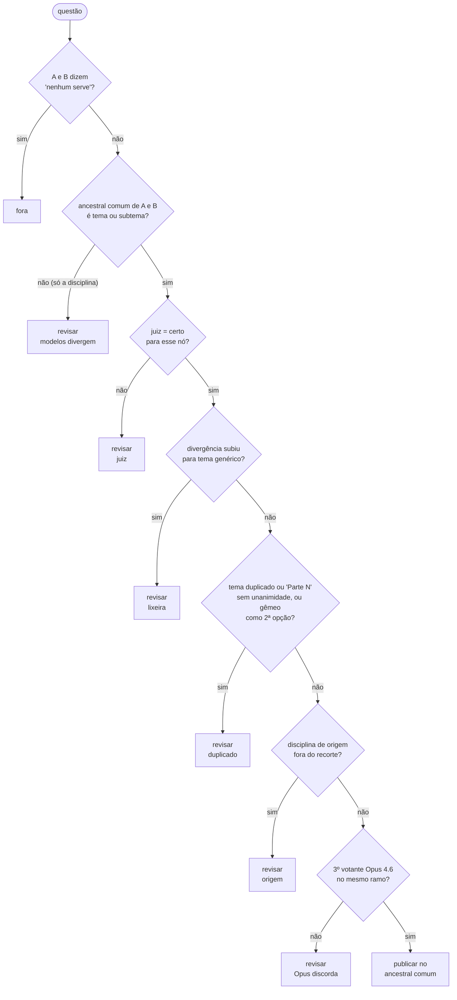
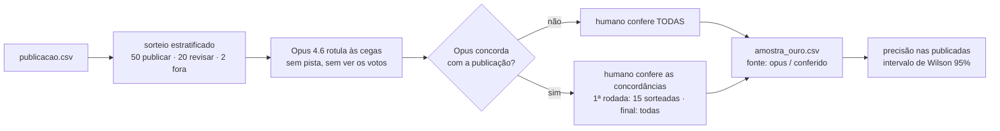
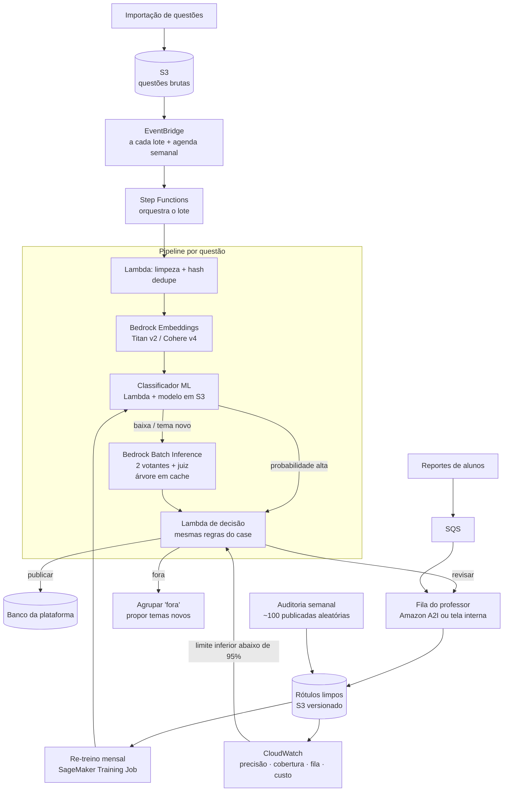
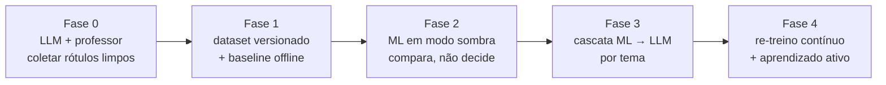

# Arquitetura e estratégia

Este documento descreve **como** o classificador foi construído, **por que** cada peça existe e **como** ele evolui em produção, incluindo a entrada do ML. O resumo para avaliação está em [`relatorio.md`](../relatorio.md); os comandos estão no [`README.md`](../README.md).

> **Resultado final:**
> - **191/359 publicadas (53,2%).**
> - **Precisão medida:** 46/46 na amostra conferida por humano (Wilson 95%: 92,3%–100%).
> - **Previsão entregue:** 96% (91–99%).
>
> Detalhes na seção 6.

---

## 1. O problema em uma frase

Para cada uma das 359 questões, escolher entre três decisões:
- **publicar** num tema (vai direto para o aluno);
- **revisar** (vai para o professor, com uma sugestão);
- **fora** (nenhum tema serve).

A meta é **≥95% de acerto nas publicadas**, publicando o máximo possível dentro disso.

O ponto central do desenho: **classificar é fácil; saber quando *não* publicar é o difícil.** Toda a arquitetura existe para responder a uma pergunta: *em quais questões existe evidência independente de que o tema está certo?*

### A régua

- Conta como certo publicar no tema do gabarito **ou num nó do mesmo ramo** (pai ou filho).
- Publicar num subtema irmão é erro.

A função `mesmo_ramo()` (`decidir.py`) implementa exatamente isso e tem autoteste.

---

## 2. Decisões de estratégia

| Decisão | Por quê | Alternativa descartada |
|---|---|---|
| **LLM, não ML treinado** | Não há nenhuma questão rotulada, e são 377 temas para 359 questões: menos de 1 exemplo por tema mesmo rotulando tudo. | Classificador supervisionado (fica para produção, seção 9). |
| **Árvore inteira no prompt, com cache** | São 375 temas ativos, ~12,8 mil tokens. Com prompt caching, cada leitura custa ~10% do preço normal, e o tema certo nunca fica fora da lista. | Embeddings para filtrar o top-k (acrescentaria o erro de *recall*). |
| **Dois votantes de famílias diferentes** | Sonnet 4.6 e Haiku 4.5 erram de formas diferentes. Quando os dois concordam, é uma evidência mais forte que a "confiança" declarada pelo próprio modelo. | Um LLM com autoavaliação de confiança (mal calibrada). |
| **Entradas diferentes para cada votante** | Só o votante A vê `disciplina/assunto_origem`. Se os dois vissem a mesma pista errada, concordariam no erro, e é a concordância que libera a publicação. | Pista para ambos ou para nenhum. |
| **Juiz em prompt separado** | Um terceiro olhar com outro enquadramento: só o tema proposto, os subtemas e os irmãos dele. | — |
| **Opus 4.6 como 3º votante** (adicionado depois da 1ª medição) | Os 2 votos + o juiz deram 92% na amostra. Os erros eram questões entre dois temas, e o modelo mais forte, rodando às cegas, discordou em todos. | Aceitar 92%; ou criar uma regra sob medida para os 4 erros (pareceria bom na amostra e seria falso). |
| **Publicar no tema pai na dúvida entre irmãos** | Pela régua, o tema de nível 1 é correto para qualquer subtema dele. | Mandar toda divergência para revisão (perde cobertura sem ganhar precisão). |
| **Nunca publicar na disciplina raiz** | Tecnicamente conta como certo, mas é o comportamento que criou as "lixeiras". | — |
| **Flags de risco nos temas** | Duplicados entre disciplinas, irmãos "(Parte N)" e títulos genéricos são onde os modelos (e os humanos) se dividem. | — |
| **Saída estruturada com `enum` dos ids reais** | Sem isso, o Haiku inventava ids vizinhos (5688 no lugar de 4688). | Validar só depois, no código (perdia o voto). |
| **Precisão medida numa amostra rotulada** | É a única forma honesta de estimar o acerto sem gabarito. | Confiar na taxa de "certo" do juiz (ele quase nunca discorda; ver seção 7). |

---

## 3. Arquitetura do case

### 3.1 Componentes

| Arquivo | Responsabilidade | Entradas | Saídas |
|---|---|---|---|
| `preparar.py` | Limpa o HTML (` `, entidades, `\n` literal) e monta o texto *enunciado + comando + alternativas*. Monta a árvore só com os temas ativos, indentada por nível, com as 20 descrições reais (as automáticas são descartadas). Marca as flags de risco. | `dados/questoes.jsonl`, `dados/temas.csv` | estruturas em memória; `cache/arvore.txt` |
| `classificar.py` | Todas as chamadas ao Bedrock. Primeira chamada sozinha (grava o cache de prompt), o resto com 4 em paralelo. Retries `adaptive` do botocore. Grava as respostas em JSONL; uma nova execução só chama o que falta. | árvore, questões | `cache/votos_A.jsonl`, `votos_B.jsonl`, `juiz.jsonl`, `rotulos_opus.jsonl` |
| `decidir.py` | Funções da árvore (`pai`, `ancestrais`, `mesmo_ramo`, `no_candidato`), regras de decisão, confiança, validador, amostra-ouro, avaliação com Wilson. | caches + `amostra_ouro.csv` | `publicacao.csv`, `cache/conferir.md` |
| `prompts/classificar.md` | Instruções + `{arvore}`. É o prefixo fixo, cacheado. | — | — |
| `prompts/juiz.md` | Instruções curtas do verificador. | — | — |

### 3.2 Integração com a AWS

- **Serviço:** Amazon Bedrock, região `us-east-1`, com perfis de inferência `us.` (*cross-region inference*).
- **Cliente:** `boto3` → `bedrock-runtime.invoke_model`, com o corpo da Messages API da Anthropic (`anthropic_version: bedrock-2023-05-31`). É o mesmo JSON que o SDK da Anthropic enviaria; o `converse` exigiria traduzir o cache e a saída estruturada.
- **Credenciais:** o perfil default do AWS CLI (ou outro, via `AWS_PROFILE`). O `botocore[crt]` permite usar perfis criados com `aws login`. **Nenhuma credencial no código ou no git.**
- **Recursos da API usados:**

  | Recurso | Para quê |
  |---|---|
  | `cache_control: ephemeral` | Cachear a árvore (TTL de 5 min, renovado a cada uso). |
  | `output_config.format` (JSON Schema) | Resposta estruturada, com `enum` dos ids. |
  | `output_config.effort` + `thinking: adaptive` | Profundidade de raciocínio (Sonnet e Opus; o Haiku 4.5 não aceita). |
  | `max_tokens` baixo (1.500 nos votos) | Cortar cedo os raros laços de repetição. |

- **Modelos:** o plano previa Sonnet 5.5 + Haiku 5.5, mas a conta responde `not available for this account` para toda a família 5.x e para o Opus 4.7+. Ficaram os mais novos liberados: **Sonnet 4.6, Haiku 4.5 e Opus 4.6**.

---

## 4. Regras de decisão

As regras foram fixadas **antes** de olhar a amostra, para não ajustar o resultado aos dados de avaliação. Elas são avaliadas em ordem:

- **O "ancestral comum mais baixo"** (`no_candidato`):
  - mesmo nó → esse nó;
  - pai e filho → o pai;
  - subtemas irmãos → o tema;
  - temas diferentes → só a disciplina, e então não publica.
- **Confiança (`confianca`):** é o acerto observado na amostra **para o grupo** da decisão (`unanime`, `ramo`, `revisar_*`, `fora`), com suavização de Laplace. Antes da amostra existir, usa valores iniciais declarados no código.

---

## 5. Diagnóstico dos dados

Esta seção resume só o que muda a arquitetura; o detalhe está no relatório.

| Achado | Efeito no desenho |
|---|---|
| **16 temas duplicados** entre disciplinas (Lei Maria da Penha, Abuso de Autoridade, Ação Penal, LEP...) | Flag `duplicado`: exige unanimidade e nenhum "gêmeo" como 2ª opção. |
| **16 temas em "(Parte N)"** irmãos do tema completo (Teoria da Pena, Competência, Sentença...) | Flag `parte`: mesma regra. |
| **25 títulos genéricos** (Introdução, Teoria Geral, Princípios, Conceito...) | Flag `lixeira`: não aceitam publicação "por divergência". |
| **Só 20 descrições reais**; 337 automáticas e 20 vazias | Só as reais entram no prompt. |
| **`assunto_origem` não confiável** (143/359 batem com um tema; 18 vazios) | É pista, só para um votante. |
| **Disciplinas de origem fora do recorte** | Vira alerta (revisar), não `fora` automático. |
| **2 temas inativos** | Listados no prompt como proibidos → `nenhum_serve`. |

---

## 6. Como a precisão é medida sem gabarito

1. **Estratificação.** A precisão é medida só nas publicadas, então elas são a maioria da amostra. Como o sorteio é aleatório dentro do grupo, a estimativa não tem viés.
2. **Pré-rótulo às cegas.** O Opus é o modelo mais forte disponível. Ele não vê a escolha dos votantes nem a pista de origem.
3. **Conferência humana focada.**
   - Todas as divergências entre o Opus e a publicação: são as que podem ser erros.
   - 15 concordâncias sorteadas: medem o risco principal, que é o Opus, da mesma família do Sonnet, concordar com ele por viés e não por acerto.
4. **Intervalo de Wilson.** Com 50 publicadas na amostra, o intervalo é largo, e isso é declarado, não escondido.
5. **Desconto de convenção.** Mesmo um rótulo humano pode divergir da *convenção* dos especialistas (qual duplicado, qual "Parte"). A previsão final fica abaixo da medida e com o intervalo mais largo.
6. **Foi o que aconteceu.** A 1ª medição deu 46/50 = 92%, e a conferência humana confirmou os 4 erros (o Opus concordou com o humano em 19/19). A regra foi apertada com o **Opus 4.6 como 3º votante**: só publica se ele também cair no mesmo ramo. A partir daí, a precisão é medida **só com rótulos conferidos por humano**, porque usar o Opus como votante e como gabarito seria circular. Por isso, todas as publicadas da amostra passam por conferência humana.

### Resultado

| Métrica | 1ª medição (2 votos + juiz) | Final (+ Opus como 3º votante) |
|---|---|---|
| Publicadas | 201/359 = 56,0% | **191/359 = 53,2%** |
| Revisar · fora | 156 · 2 | **166 · 2** |
| Precisão na amostra (conferida por humano) | 46/50 = 92% (Wilson 81,2%–96,8%) | **46/46 = 100% (Wilson 92,3%–100%)** |
| Por grupo | `unanime` 39/43 · `ramo` 7/7 | `unanime` 39/39 · `ramo` 7/7 |
| Previsão entregue (`previsao.txt`) | — | precisão **96%** (91–99%) · cobertura **53%** (51–55%) |

- **Motivos das 166 revisões:** 119 divergência entre A e B · 23 duplicado/parte · 9 Opus discorda · 9 juiz · 3 origem fora do recorte · 2 genérico · 1 sem voto do Opus.
- **Os 4 erros da 1ª medição** são questões que cruzam dois temas: absolvição sumária × apelação; Pacote Anticrime (ANPP × hediondos); colaboração premiada (Processo Penal × Organizações Criminosas); exame de corpo de delito × perícia. Em 2 deles, um votante tinha indicado como 2ª opção exatamente o tema do Opus.
- **Por que a previsão é 96% e não 100%:**
  - a convenção dos especialistas é desconhecida;
  - quem conferiu via o rótulo do Opus;
  - a regra foi escolhida depois da 1ª medição;
  - n = 46 é pequeno.

  O raciocínio completo está no `previsao.txt`.

---

## 7. Becos sem saída e lições

| O que aconteceu | O que fizemos |
|---|---|
| Os modelos 5.x não estão disponíveis na conta (Mantle: 404; InvokeModel: 403 *not available for this account*). | Usar Sonnet 4.6, Haiku 4.5 e Opus 4.6 via `invoke_model` com perfil `us.`. |
| O Haiku inventou ids vizinhos dos reais (3 em 30). | `enum` dos ids no JSON Schema. Os votos da 1ª versão ficaram arquivados em `cache/v1/`. |
| Laços raros de repetição até o limite de tokens (~2%). | Teto baixo de `max_tokens` + segunda rodada só para as falhas. |
| O juiz quase nunca discorda (barrou 9 de 238). | Ele é mantido como filtro barato, mas **não** serve como estimativa de precisão; quem mede é a amostra. |
| Só 2 questões em `fora`: os modelos raramente dizem "nenhum serve". | Ponto a investigar (prompt ou exemplos); hoje o custo é de cobertura, não de precisão. |
| O SDK da Anthropic foi trocado por boto3. | Mesmo corpo de requisição; validado com 3 questões (temas idênticos e cache funcionando). |
| 1ª medição: 92%, abaixo da meta. | Opus 4.6 como 3º votante em todas as publicáveis, e medição só com rótulos humanos (seção 6). |
| `ThrottlingException` do Opus na conta (95 de 151 na 1ª passada). | Nova rodada com 2 chamadas em paralelo, só para as falhas. |
| A Q0293 estoura o limite de raciocínio do Opus (8 mil tokens) em todas as tentativas. | Fica em `revisar` por falta do 3º voto. |

---

## 8. Custos e tempo (medidos)

Calculado pelos tokens de cada chamada, a preço de lista (US$ por milhão de tokens: Sonnet 4.6 3/15, Haiku 4.5 1/5, Opus 4.6 5/25; leitura de cache = 0,1× a entrada, escrita = 1,25×). O Bedrock pode cobrar um pouco diferente.

| Etapa | Chamadas | Custo |
|---|---|---|
| Votante A (Sonnet 4.6) | 359 | US$ 2,98 |
| Votante B (Haiku 4.5) | 359 | US$ 1,13 |
| Juiz (Sonnet 4.6) | 238 | US$ 1,72 |
| Pré-rótulo da amostra (Opus 4.6) | 72 | US$ 2,77 |
| 3º votante nas publicáveis (Opus 4.6) | 150 | ~US$ 5,25 |
| 1ª versão, testes e chamadas que estouraram o limite de tokens | — | ~US$ 1,40 |
| **Total** | | **~US$ 15,30** |

- **Por questão,** no pipeline final (2 votos + juiz em todas, Opus só nas publicáveis): **~US$ 0,036**.
- **Efeito do cache:** sem ele, só os dois votos custariam ~US$ 25.
- **Tempo:**
  - ~40 min para as 359 questões com 4 chamadas em paralelo;
  - ~15 min para o Opus nas 72 da amostra;
  - ~1 h para o Opus nas 150 publicáveis, por causa do limite de requisições da conta.

---

## 9. Produção: 50 mil questões por semana

### 9.1 Princípios

1. **Não reclassificar tudo toda semana.** Só entram questões novas, alteradas (hash do texto diferente) ou reportadas. Questão repetida herda o rótulo.
2. **As mesmas regras de decisão do case,** já testadas e auditáveis.
3. **O professor é parte do sistema, não um anexo:** cada revisão vira um rótulo limpo.
4. **Qualidade medida toda semana,** com amostra aleatória, nunca só com a fila de revisão (que tem viés: só tem casos difíceis).

### 9.2 Arquitetura na AWS

### 9.3 Onde entra cada tipo de IA

| Tipo | Papel em produção | Quando |
|---|---|---|
| **Embeddings** | Representação de cada questão: entrada do classificador, detecção de duplicatas e agrupamento das `fora`. | Desde o início |
| **Classificador treinado (ML)** | O "cavalo de carga": resolve os casos de alta probabilidade a custo ~zero. | Quando houver rótulos limpos suficientes |
| **LLM** | Casos de baixa confiança, temas novos ou com poucos exemplos, e mudanças na árvore. | Sempre, numa fatia cada vez menor |
| **Agentes** | Fora do caminho principal: investigar temas com muitos reportes e propor temas novos a partir dos grupos de `fora`. | Depois do ML estável |
| **Professor** | Decide os casos difíceis, faz a auditoria semanal e define a convenção dos temas. | Sempre |

---

## 10. Plano de ML

### 10.1 Por que não agora, e por que sim depois

- **Agora:** não há rótulos. Os rótulos atuais da plataforma **são o problema** (as lixeiras): treinar neles ensina o modelo a repetir o erro.
- **Depois:** cada revisão do professor, cada auditoria e cada rótulo dos especialistas que a empresa já tem formam um conjunto **limpo** que cresce toda semana. A partir de algumas dezenas de exemplos por tema, um classificador simples sobre embeddings costuma igualar o LLM nos casos fáceis, a um custo centenas de vezes menor.

### 10.2 Fases

| Fase | O que acontece | Critério para avançar |
|---|---|---|
| **0. LLM + professor** | É o pipeline deste case em produção. Toda decisão do professor é gravada com: questão, tema escolhido, sugestão do sistema, versão da árvore e data. | ≥ 5 mil rótulos limpos e ≥ 20 exemplos em boa parte dos temas |
| **1. Dataset e baseline** | Embeddings de todas as questões rotuladas. Separar treino, validação e teste **por data**, para simular o futuro. Treinar a baseline e medir offline contra o LLM. | ML ≥ LLM nos temas com dados suficientes, no conjunto de teste |
| **2. Modo sombra** | O ML roda junto com o LLM em produção, **sem decidir**. Compara as decisões semana a semana. | 4 semanas com a precisão estimada do ML ≥ 95% nos casos em que ele publicaria |
| **3. Cascata** | O ML decide sozinho quando a probabilidade calibrada passa do limiar **daquele tema**. O resto vai para o LLM. Divergência entre ML e LLM vai para o professor. | — |
| **4. Contínuo** | Re-treino mensal, monitoramento de deriva e aprendizado ativo. | — |

### 10.3 O modelo

- **Entrada:** embedding da questão (Titan Text Embeddings v2 ou Cohere Embed v4, via Bedrock), mais atributos baratos (disciplina de origem, tamanho, número de assertivas).
- **Modelo:** **regressão logística multiclasse** (ou LightGBM) sobre os embeddings. Treina em minutos com 50 mil exemplos e é fácil de auditar.
- **Hierarquia sem complicação:** prever a probabilidade de cada nó e **somar a probabilidade dos subtemas no tema pai**. A decisão escolhe o nó **mais profundo** cuja probabilidade acumulada passa do limiar. É a mesma lógica do "publicar no pai" do case, só que com números calibrados.
- **Calibração:** regressão isotônica (ou Platt) no conjunto de validação. Assim, "0,97" significa 97% de acerto de verdade.
- **Limiar por tema:** escolhido no conjunto de validação para que o **limite inferior de Wilson** da precisão fique ≥ 95%. Tema com poucos dados não tem limiar e vai sempre para o LLM.
- **Hospedagem:** o artefato do modelo fica no S3 e a inferência roda numa **Lambda** (scikit-learn), sem endpoint do SageMaker ligado 24h. O SageMaker entra só para os jobs de treino e o registro de versões (Model Registry).
- **Evolução possível:** com dezenas de milhares de rótulos, testar o *fine-tuning* de um encoder em português (BERTimbau ou similar) contra a baseline. Só adotar se ganhar no conjunto de teste.

### 10.4 Cuidados que não podem faltar

| Risco | Cuidado |
|---|---|
| Treinar nos rótulos sujos atuais | Usar **só** rótulos com origem humana conferida (professor, especialistas, auditoria). |
| Viés da fila de revisão (só casos difíceis) | A estimativa de precisão vem da **auditoria aleatória**, nunca da fila. |
| Mudança na árvore (unificar duplicados, extinguir "Parte N") | Versionar a taxonomia. Manter uma tabela de **remapeamento** de rótulos antigos para novos e re-treinar a cada mudança. |
| Tema novo sem exemplos | O ML não sabe que ele existe: o caminho é o LLM até juntar exemplos suficientes. |
| Deriva (novas bancas, nova legislação) | Alerta quando a distribuição de temas ou a confiança média da semana muda muito. |
| Questões quase iguais em treino e teste | Deduplicar por similaridade de embedding antes de separar os conjuntos. |
| Desbalanceamento (temas com 2 questões × 500) | Pesos por classe e limiar por tema. |

### 10.5 Aprendizado ativo: a fila do professor rende mais

O professor não recebe a fila em ordem aleatória:
- **as questões de maior incerteza do ML** (as que mais ensinam ao modelo);
- **os temas com menos exemplos;**
- **uma fatia aleatória fixa,** que mantém a estimativa de qualidade sem viés.

### 10.6 Métricas de produção (painel no CloudWatch)

| Métrica | Meta / uso |
|---|---|
| Precisão das publicadas (auditoria semanal, Wilson 95%) | Limite inferior ≥ 95%; se cair, o limiar sobe automaticamente |
| Cobertura (fração publicada automaticamente) | Subir mês a mês |
| Fila de revisão (tamanho, tempo até decisão) | Caber no tempo do professor |
| Reportes de alunos por mil questões vistas | Alerta por tema |
| Fatia decidida pelo ML × LLM × professor | Mostra a evolução da cascata |
| Custo por questão | Ver abaixo |

### 10.7 Custo estimado por questão

Preços de lista, a confirmar no Bedrock:

| Caminho | Custo por questão |
|---|---|
| ML (embedding + Lambda) | ~US$ 0,0001 |
| LLM on-demand (2 votos + juiz + Opus nas publicáveis, com cache; medido neste case) | ~US$ 0,036 |
| LLM via Batch Inference (~50% mais barato, a confirmar) | ~US$ 0,018 |

| Cenário semanal | Custo por semana |
|---|---|
| 5 mil questões novas, só LLM (Fase 0) | ~US$ 180 (~US$ 90 em batch) |
| Reprocessar as 50 mil, só LLM | ~US$ 1.800 (por isso só entram novas, alteradas ou reportadas) |
| Fase 3, com o ML resolvendo ~70% das 5 mil novas | ~US$ 55 |

Com acesso aos modelos 5.x (o Haiku 5.5 custa 10× menos que o Haiku 4.5), o caminho LLM fica bem mais barato.

O custo que mais pesa continua sendo **o tempo do professor**. O objetivo do ML é encolher a fila, não a conta da AWS.

---

## 11. Roteiro

| Quando | Entrega |
|---|---|
| Case (agora) | Pipeline LLM + regras + amostra-ouro + previsão de precisão |
| Mês 1 | Pipeline em produção com Step Functions e fila do professor; unificação dos temas duplicados e "Parte N" com o professor |
| Meses 2–3 | Auditoria semanal funcionando; dataset de rótulos limpos versionado; embeddings de todo o banco |
| Meses 3–4 | Baseline de ML offline; modo sombra |
| Mês 5 em diante | Cascata ML → LLM por tema; re-treino mensal; agente para os grupos de `fora` e os temas mais reportados |

---

## 12. Limitações conhecidas

- **Amostra pequena:** 46/46 na amostra conferida, mas com n = 46 o limite inferior de Wilson é 92,3%. O gabarito é humano e não da equipe, e quem conferiu via o rótulo do Opus.
- **Convenção dos especialistas desconhecida** para os duplicados e as "Partes". É o maior risco de divergência com o gabarito oficial.
- **Votante B fraco:** o Haiku 4.5 é o principal motivo de divergência, e isso reduz a cobertura. Os modelos 5.x não estavam disponíveis.
- **Juiz pouco discriminativo** (9 discordâncias em 238).
- **Poucas `fora`:** os modelos tendem a sempre achar algum tema.
- **Custos a preço de lista,** não conferidos na fatura da AWS.
